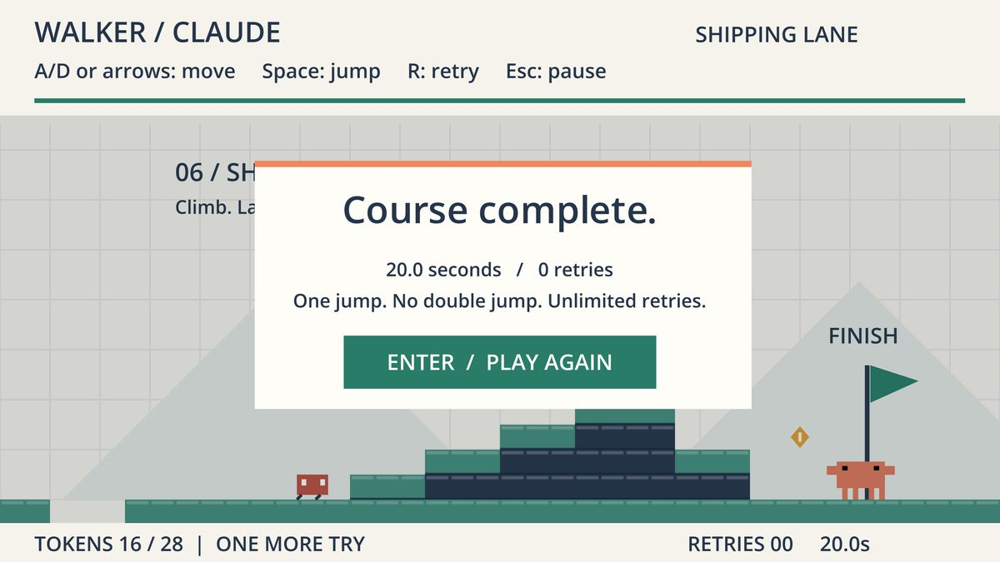
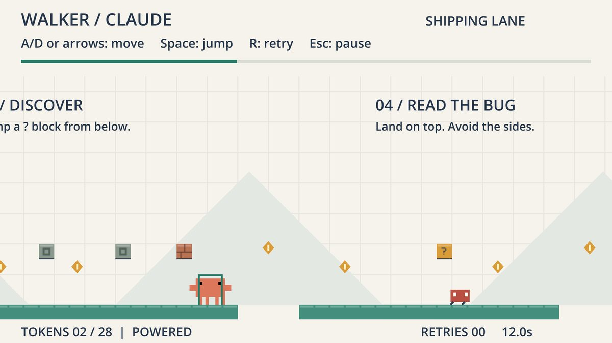

# 03. Build: A Game (the Claude Jumpman)

*Status: DRAFT, not yet dry-run. One group of about five, 65 minutes. Highest-risk track: needs Godot installed.*

## Executive summary

**What this is.** A group opens a small, finished 2D platformer starring Clawd, the Claude mascot, in the free Godot game engine, and changes it with an AI: a new level layout, a new enemy behavior, a new feel for the jump. They play it, watch a stranger play it, and fix what they see. **Why this track.** It is the most vivid way to see that the AI writes the code and **a person decides what makes it fun.** **What the group leaves with.** A changed game, running live, with a note on what a real playtester did that the group did not expect.

| | |
|---|---|
| **Kit** | [kits/game](../kits/game/README.md) |
| **Student pack** | [kits/game/PACK.md](../kits/game/PACK.md). Each student picks a different feel and numbers |
| **Tool** | Godot 4.7.2 on the coach's laptop, plus an AI chat |
| **Roles** | Driver (keyboard), Designer (what to change), Playtester (plays), Demo captain |
| **Coach** | Someone comfortable opening Godot. If nobody is, use the browser fallback. |

## What the finished build looks like

A small 2D platformer starring the Claude mascot: run, jump, collect tokens, stomp bugs, reach the flag. These are real screens from the game. A group's version looks the same but plays differently, with a higher or floatier jump, or a changed level.

## The two jobs in this track

- **Master it:** Direct it. Describe a change precisely, paste the right file, run it, and paste the error back.
- **Keep it human:** What makes it fun is a human call, and only a human playing it can tell you.

## Prep (coach, before the day)

Install Godot 4.7.2. Download the game, open `godot/project.godot`, play it, and make one change with the AI end to end. Find which file does each thing in the build menu. Check the editor's first-run import time. Bring a finished example.

## Run of show (65 minutes)

1. **Play it (5 min).** Everyone plays for two minutes. Say what you would change.
2. **Spec it (7 min).** Pick **one** item from the kit's build menu. Write it as one sentence, then the three lists: **must keep** (the controls, the goal), **may change**, **must ask me** (anything that changes how it feels).
3. **Build (28 min).** The driver pastes the relevant file into the AI with the starter prompt, applies the new file, and runs the game. If Godot shows an error, paste it back. Rotate the driver every eight minutes. Change one thing at a time and run after each.
4. **Catch (10 min).** Pull in one person from another group. They play for two minutes. **Do not speak.** Write down where they died, where they paused, what they tried that you did not expect. Fix one thing you saw.
5. **Ledger and demo prep (10 min).** Fill the ledger. Decide what to show live in 90 seconds.
6. **Buffer (5 min).**

## The things to catch

A jump that now makes the level impossible. A bug that sticks to the wall. A change that technically works and is not fun. An AI that rewrote more of a file than you asked.

## Debrief questions

- What did the stranger do that you did not predict?
- What did the AI change that you did not ask for?
- Who decides when the game is "done"?

## Unplugged and browser fallback

If Godot will not run, use the browser fallback in the kit: paste the level file and have the AI build a single-page version. Name the difference out loud. If that fails, redesign the level on paper over the level map and have the coach act it out.

## Watch-outs

- Pin everyone to **Godot 4.7.2**.
- The repository has no license file yet. Link to it; do not redistribute it.
- Human playtesting of the game is pending, so the group's findings are real news.
