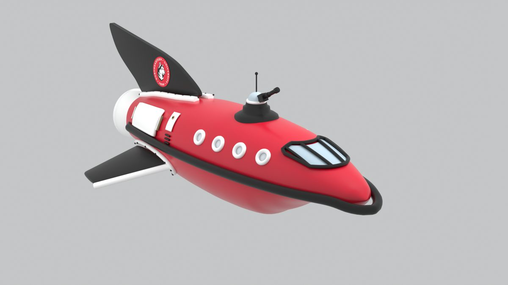
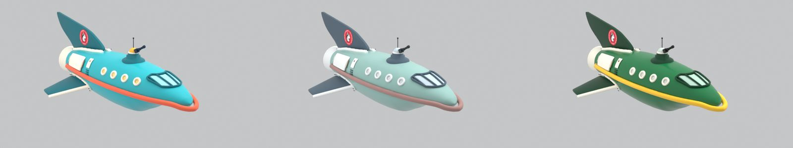
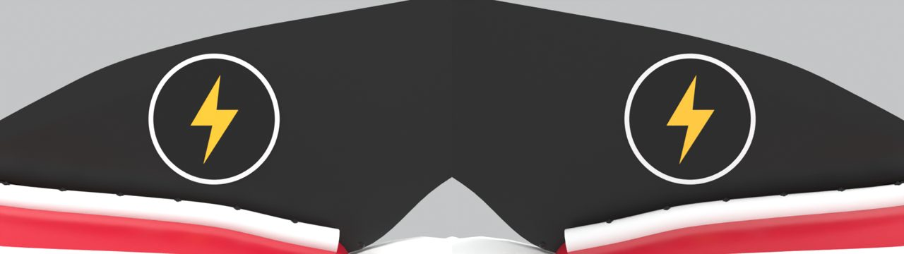
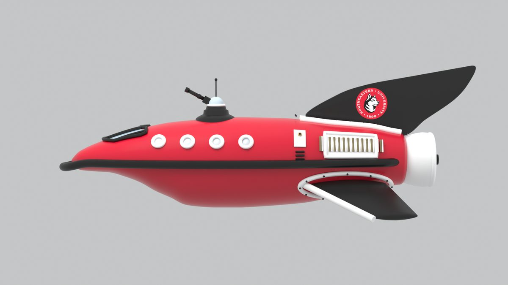
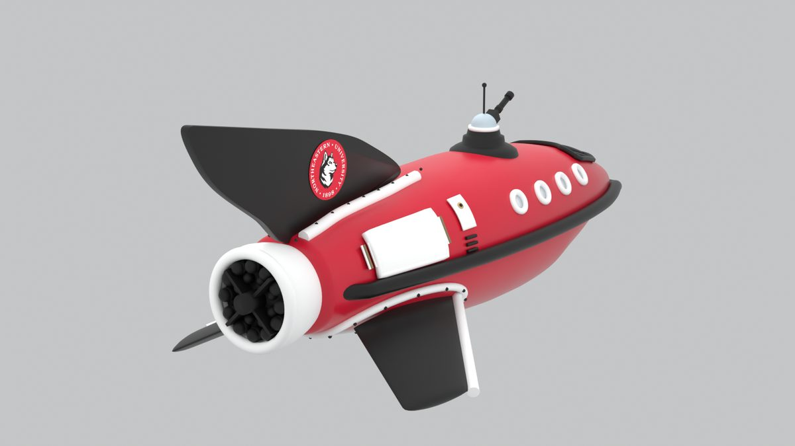

# 04. Build: A 3D Model (a Blender ship variant)

*Status: DRAFT. The rebuild loop was tested once, with Claude editing the settings file; it has not been tried with any other AI or with students. One group of about five, 65 minutes.*

## Executive summary

**What this is.** A group takes a cartoon delivery spaceship that a script builds in Blender, and makes their own **variant** of it by changing its settings file: a new color scheme, a new theme, one proportion. They see the result in about 20 seconds after each change. **Why this track.** The ship is built entirely by a script from one settings file, so a simple AI can change it by editing a few lines. That is the whole lesson: **give a simple tool enough information and it can do real work, and a person still has to look at what comes out and decide if it is right.** **What the group leaves with.** A new ship they designed, a render of it, and a ledger.

| | |
|---|---|
| **Kit** | [kits/3d](../kits/3d/README.md) |
| **Student pack** | [kits/3d/PACK.md](../kits/3d/PACK.md). Each student picks a theme, palette and one number |
| **Tool** | Blender on the coach's laptop (free), the ship folder, a text editor, and an AI chat. A free simple model works |
| **Roles** | Driver (keyboard), Designer (the brief), Checker (reads every render critically), Demo captain |

## What the finished build looks like

A cartoon delivery spaceship, rendered from the build script. Below: the base ship in Northeastern colors, then three variants made only by changing the colors block. Your group's will have its own palette, one changed number, and maybe its own emblem.

The emblem on the tail fin has to read correctly from both sides. This check shows a plain bolt emblem on each side of the fin:

| Side view | Rear view |
|---|---|
|  |  |

## The two jobs in this track

- **Master it:** Spec it and direct it. Hand the AI the settings file and a precise brief, and get back a change that runs.
- **Keep it human:** The design is yours. Decide what the variant is for, what it should look like, and whether the render matches the brief. Check it from more than one angle.

## Prep (coach, before the day)

Install Blender. Copy the ship folder to the laptop. Run `build.command` once, and open the picture it makes. Make one change to the settings with the AI you will use on the day, and rebuild. Note how long it took and anything the AI got wrong (a bad color code, broken JSON, the wrong key). Pin the Blender version and write it down. Bring a finished example.

## Run of show (65 minutes)

1. **Look (5 min).** Open the base renders. Name the parts: hull, stripe, trim, fin, wings, windows, engine. Open `params.json` and find the colors.
2. **Spec it (7 min).** Write a one-sentence brief for a variant: *who is this ship for, and what should it feel like?* A school, a team, a club, a made-up company. Then three lists: **must keep** (the file must stay valid, the ship must still build), **may change** (colors, one proportion), **must ask me** (anything outside the settings file).
3. **Build (28 min).** The driver gives the AI the colors block and the brief, and asks for the replacement block. Paste it into the settings file and save. Double-click `build.command`. Look at the picture. Rotate the driver every eight minutes. Change one thing at a time.
4. **Catch (10 min).** Compare the render to your brief. Look at the side view and the fin, not just the front. Did the AI pick colors that match the words? Did it change what you asked and nothing else? Did it break the file? Write the Catch Card.
5. **Ledger and demo prep (10 min).** Fill the ledger. Decide what to show live: the base ship, your variant, and the one change that mattered.
6. **Buffer (5 min).**

## The things to catch

A color code that is not a color. A file the AI broke with a stray comma. A palette that does not match the brief ("warm and friendly" that came back cold). A change that fixed the front and left the back wrong. A logo that changed on only one side of the fin. An AI that changed more than you asked.

## Debrief questions

- What did the AI need to know that you had not told it?
- Which change was a design decision, and which was just editing?
- What would you check on a ship you were going to print or publish?

## Unplugged fallback

If Blender or the AI fails, use the printed base renders. Color the ship by hand to your brief, then write the settings you would have given the AI. Name what you did not get to run.

## Watch-outs

- The ship is a copyrighted character design. Keep variants in the room.
- If your variant uses a real school's or company's marks, follow their rules. The group's own invented marks are the safe default.
- Blender is a large download. Install it before the day.
